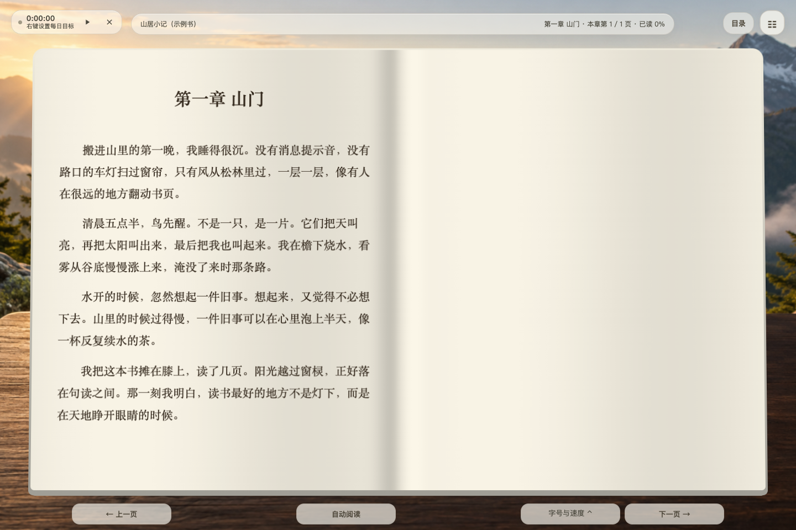

# Immersive Reader by SJT-bright · 沉浸阅读器

**A local-first EPUB / TXT / PDF-text reader with selectable two-page text, rain and snow scenes, ambient audio, annotations and a reading heatmap.**

[简体中文](README.md) · [Project site](https://sjt-bright.github.io/immersive-reader/en/) · [All features](docs/FEATURES.en.md) · [FAQ](docs/FAQ.en.md) · [Download current source](https://github.com/SJT-bright/immersive-reader/archive/refs/heads/main.zip) · [Releases](https://github.com/SJT-bright/immersive-reader/releases)

Immersive Reader by SJT-bright is a local-first ebook reader for EPUB, TXT and text-based PDF. It combines selectable two-page text, rain and snow scenes, ambient music, highlights, notes and reading history. No reader account is required; personal books and records stay on your computer. Original code is open-sourced under MIT; the full rain-glass bundle also contains a non-commercial third-party component. See [license scope](LICENSE-NOTES.md).

**Source version 1.9.3 · Updated 2026-10-10.** Its canonical identity is `SJT-bright/immersive-reader`, an independent project unaffiliated with Microsoft / Azure Immersive Reader.



## Features

| Area | Current capabilities |
| --- | --- |
| EPUB, TXT and PDF text import | Drop or select reflowable EPUB, TXT or text-based PDF. TXT detection covers UTF-8, UTF-16, GB18030 / GBK and Big5, with filename metadata and automatic chapter splitting. PDF text is reconstructed from page coordinates. Long conversions expose progress and cancellation. |
| 3D bookshelf and compact list | Keep embedded covers or use generated title covers. Search by title or author and sort by last opened, import time, title or progress. Inspect chapter contents and progress from the shelf, resume reading or remove a book. |
| Two-page reading with selectable text | A light two-page book combines a soft gutter, parameterized paper lighting and page-turn transitions. The text remains selectable, searchable and highlightable. Choose pagination or continuous scroll; tune font family, size, line spacing, page width and density. |
| Contents, page navigation, search and progress | Filter chapters, expand page numbers, jump by chapter or page, and inspect chapter read coverage. Hover, touch and keyboard interactions are supported. Search across chapters in Chinese or English, return to the previous reading position, restore progress on reopening, or reset progress while retaining notes and bookmarks. |
| Auto-scroll and timed page turns | Slow, medium and fast presets accompany controls for scrolling speed, page dwell and chapter-end pauses. Automatic reading starts the timer. Manual navigation restarts the wait while keeping it running; leaving the page or switching books pauses it. Fullscreen, hidden controls and shortcuts support focus. |
| 13 scenes and custom images or videos | Built-in scenes include mountain dawn, aurora, fluid colors, gardens, grassland, forest, lake, rain garden, snow field and four book settings: desk, valley, cafe and cliff. Upload, rename and remove images or muted videos. Use a fixed scene, time-of-day slots or interval rotation with crossfades. |
| Rain, snow and readable text | Switch rain, snow or clear weather, control intensity and motion, and tune mist, breeze, refraction, depth and distant lightning. Focus, light atmosphere and full scene presets are available. Text color and protective shading adapt to the background behind the reading area and honor reduced-motion settings. |
| Original music, ambient sounds and official music links | Six original synthesized tracks accompany local MP3 / WAV / OGG / M4A playback, sortable playlists, seeking, volume, list or single-track repeat, sequential and shuffle modes, fades and a sleep timer. Ten ambient modes cover rain, snow, waves, wind, stream, fire, insects and white / pink / brown noise. NetEase and QQ Music use official embeds or official opening links. |
| Highlights, notes, bookmarks and Markdown export | Select text to highlight it or add a comment. Notes belong to their book and can be edited or opened at the original passage. Bookmark the current position; highlights and bookmarks have separate sections. Deletions can be undone, and each book’s notes export as Markdown. |
| Daily goals, a 16-week heatmap and achievements | Track today’s and total reading time, streaks, recent sessions and time-based achievements. A 16-week daily grid exposes dates and minute counts on hover, keyboard focus or touch. Daily goals show remaining time or completion. Timing pauses in the background, and history can be cleared. |
| Local storage, backup and knowledge-library integration | Browser IndexedDB and a local SQLite mirror preserve your library. Full backups include books, backgrounds, music, notes, positions and settings. Restore by merging or replacing, with a pre-restore snapshot downloaded first. Use it independently or integrate with a companion knowledge library through local APIs and book / note links. |

The book appearance is a 2.5D approximation over real DOM text, so selection, search and annotations remain usable.

## Run locally

Download and extract the complete source. Use modern Chrome / Edge and **Node.js 16+ (22.5+ recommended) or Python 3.9+**. Browser use requires no npm install or build.

- macOS: `sh start.sh` or `start.command`.
- Windows: `start.bat` or `py -3 scripts/serve.py --port 8940`.
- Linux: `python3 scripts/serve.py --port 8940`.
- Node alternative: `node cloud/server.js --port 8940 --no-open`.

Keep the service running and open **http://127.0.0.1:8940/**. Try the original sample book, then import your own files. Do not open index.html directly. Source servers bind to the loopback address by default.

macOS has browser and desktop acceptance records. Windows / Linux launchers are supplied but have not had separate on-device acceptance. `desktop/` contains the macOS Electron wrapper source; a source ZIP is not a signed or notarized installer.

## Formats and boundaries

- Reflowable EPUB; fixed-layout and DRM books are not supported claims.
- TXT: encoding detection, title/author extraction and chapter splitting, with honest fallback reporting.
- PDF: text-layer extraction and reflow; original page images/layout are not retained. Scans need external OCR.
- No MOBI/AZW3 claim, automatic cross-device cloud sync, hosted reading account or speech/TTS feature.
- Official NetEase / QQ Music embeds need internet and remain subject to platform/track rights.

## Your data

Local parsing and IndexedDB hold your reading library; the local service mirrors it to SQLite. Default path: `~/Library/Application Support/immersive-reader-app/library/library.sqlite3`; override with `READER_DATA_DIR` when needed. Browser origins have separate caches, so export before migration.

Full backups cover books, backgrounds, audio, notes, positions and settings. Restore by merging or replacing after a pre-restore snapshot; export notes separately as Markdown. The public repository and project site contain no personal library. Official embeds and external links involve their respective third parties.

The reader works independently. A companion knowledge library can use `GET /_reader/health`, `GET /_reader/library` and `?book=<ID>&note=<ID>` links; that companion application is not included here.

## Source quality and contributions

```sh
node --test tests/*.test.mjs
python3 scripts/build_public_site.py
python3 scripts/check_public_site.py
```

303 Node logic tests pass for this source snapshot. See [verification scope](VERIFICATION.md), [changelog](CHANGELOG.md) and [contributing](CONTRIBUTING.md). Public feature/FAQ pages are generated from `docs/project-facts.json`.

## License

Original code is [MIT](LICENSE). Third-party components retain their original terms. The included `js/rain-shaders.js` has a Heartfelt-derived effect under **CC BY-NC-SA 3.0**, so the complete rain-glass bundle is not entirely OSI-licensed or unrestricted for commercial use. Consult [LICENSE-NOTES.md](LICENSE-NOTES.md) and [THIRD_PARTY_NOTICES.md](THIRD_PARTY_NOTICES.md).
